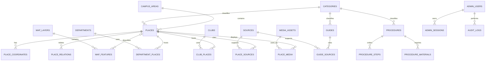

# 数据模型

> 状态：v1 逻辑模型；核心 Drizzle schema 已实现，扩展实体仍按路线图迭代
> 数据库：SQLite（生产单机），由 Drizzle 管理 schema 与迁移
> 核心原则：发布内容、来源、核验时间和坐标系必须可追溯。

## 1. 建模约定

- 主键使用应用侧生成的 UUIDv7/ULID 字符串，避免把连续数据库 ID 暴露给前台。项目落地时二选一并全局统一。
- 数据库列使用 `snake_case`，TypeScript/JSON DTO 使用 `camelCase`，映射集中在 repository/mapper，不在页面临时转换。
- 时间列以 UTC 毫秒时间戳保存（Drizzle `integer` 的 `timestamp_ms` 模式），API 输出带时区的 ISO 8601。
- SQLite 布尔值使用 `INTEGER 0/1` 并加 `CHECK`；枚举使用文本并加 `CHECK`，枚举值同步定义在 `shared/constants`。
- 所有核心表包含 `created_at`、`updated_at`。内容表另含 `status`、`published_at`、`last_verified_at`。
- `status` 统一为 `draft | published | archived`。公开 API 必须在查询层过滤 `published`，不能依赖前端隐藏。
- slug 是稳定公开标识，使用小写 ASCII、数字和连字符；同一实体表内唯一。修改 slug 时应保留重定向记录。
- 核心关系使用外键，不把 ID 数组塞进 JSON。JSON 只用于样式、可扩展元数据和修订快照。
- 启用 `PRAGMA foreign_keys = ON`、WAL 和合理 `busy_timeout`；测试环境也必须启用外键。

## 2. 关系概览

## 3. 地图与地点

### 3.1 `campus_areas`

用于表达校区或相对稳定的校园片区，避免把“旧区/新区”等自由文本散落在地点记录。

| 字段 | 类型/约束 | 说明 |
| --- | --- | --- |
| `id` | TEXT PK | 稳定 ID |
| `slug` | TEXT UNIQUE NOT NULL | 公开路径标识 |
| `name` | TEXT NOT NULL | 片区名称 |
| `summary` | TEXT | 简介 |
| `sort_order` | INTEGER NOT NULL DEFAULT 0 | 展示顺序 |
| `status` | TEXT CHECK | 草稿/发布/归档 |
| `last_verified_at` | INTEGER | 最后核验时间 |

### 3.2 `places`

校园建筑、入口、服务点、宿舍、教学楼、快递点、外卖取餐点和周边商铺都使用同一地点实体。商铺的商业主体不是地点本身，未来单独建模。

| 字段 | 类型/约束 | 说明 |
| --- | --- | --- |
| `id` | TEXT PK | 地点 ID |
| `slug` | TEXT UNIQUE NOT NULL | 公开路径标识 |
| `name` | TEXT NOT NULL | 常用名称 |
| `aliases_json` | TEXT | 经校验的别名数组，仅用于搜索 |
| `summary` | TEXT NOT NULL | 地图抽屉短介绍 |
| `body` | TEXT | 结构化正文/Markdown 源 |
| `scope` | TEXT CHECK (`campus`,`nearby`) | 校内或周边 |
| `place_type` | TEXT NOT NULL | building/dorm/classroom/gate/service/express/food/shop 等受控值 |
| `category_id` | TEXT FK | 分类 |
| `campus_area_id` | TEXT FK NULL | 所属片区；周边地点可空 |
| `address` | TEXT | 文字地址 |
| `floor` / `room` | TEXT | 室内定位说明，不假装为精确室内地图 |
| `opening_hours` | TEXT | 面向用户的时间说明；复杂时段后续结构化 |
| `phone` | TEXT | 只保存已同意公开或机构公开电话 |
| `website` | TEXT | 官方/商家主页 |
| `external_map_url` | TEXT | 外部地图兜底链接 |
| `is_official` | INTEGER CHECK | 是否为校方机构/设施，不代表信息绝对正确 |
| `is_featured` | INTEGER CHECK | 编辑精选，不用于付费推广 |
| `status` | TEXT CHECK | 发布状态 |
| `last_verified_at` | INTEGER | 最近人工核验 |
| `published_at` | INTEGER | 最近一次发布 |

关键索引：`(status, scope, place_type)`、`category_id`、`campus_area_id`、`updated_at`。名称和别名进入可重建搜索索引，不用前导通配符扫描主表。

### 3.3 `place_coordinates`

坐标不能只保存两个无上下文数字。每个地点可保存 WGS84、GCJ-02、BD-09 的一个版本；至少有一条被人工确认的原始/权威坐标，其他版本可由明确算法生成。

| 字段 | 类型/约束 | 说明 |
| --- | --- | --- |
| `id` | TEXT PK | 坐标记录 ID |
| `place_id` | TEXT FK NOT NULL | 所属地点 |
| `coordinate_system` | TEXT CHECK (`WGS84`,`GCJ-02`,`BD-09`) | 显式坐标系 |
| `longitude` | REAL CHECK -180..180 | 经度 |
| `latitude` | REAL CHECK -90..90 | 纬度 |
| `is_source` | INTEGER CHECK | 是否为采集/人工标定的源坐标 |
| `source_coordinate_id` | TEXT FK NULL | 转换自哪条坐标 |
| `capture_method` | TEXT CHECK | map_pick/gps/official_data/manual_import/transformed |
| `transform_version` | TEXT NULL | 转换算法及版本；源坐标为空 |
| `accuracy_meters` | REAL NULL CHECK >= 0 | 已知时记录估计精度 |
| `verified_at` | INTEGER | 坐标本身的核验时间 |
| `verified_by` | TEXT FK NULL | 管理员 |

约束：`UNIQUE(place_id, coordinate_system)`；`is_source = 0` 时必须有 `source_coordinate_id` 与 `transform_version`；转换链不能跨地点。服务层在写入时防止循环引用。

高德展示取 GCJ-02，MapLibre/标准 GeoJSON 底图通常取 WGS84，百度链接取 BD-09。不得在 API 消费端静默转换。转换属于近似处理，人工标定结果优先于算法转换；重新运行新算法前保留修订记录。

当前 MVP 已先落地 `place_coordinate_observations` 作为现场坐标证据链。每条观测保存地点、WGS84 聚合点、设备有效精度、1 至 10 个原始样本、采集方式、点位角色、采集时间、现场说明、审核状态、审核人和审核记录。浏览器现场采点至少需要 3 个样本；观测批准前不会写入 `places`，普通地点表单也不能直接把坐标标成 `verified`。多坐标系派生链仍按上述 `place_coordinates` 目标模型后续实现。

### 3.4 `map_layers` 与 `map_features`

点状 POI 使用 `places`；楼宇轮廓、道路、报到路线、校区边界等面/线数据放在地图要素表。

`map_layers`：`id`、`slug`、`name`、`description`、`feature_kind`、`style_key`、`min_zoom`、`max_zoom`、`sort_order`、`is_default_visible`、`status`、时间戳。

`map_features`：`id`、`layer_id`、可选 `place_id`、`name`、`geometry_type`（`Point|LineString|Polygon|MultiPolygon`）、`geometry_json`、`coordinate_system`、`bounds_json`、`style_variant`、`status`、`last_verified_at`、时间戳。

要求：

- `geometry_json` 写入前按 `geometry_type` 做结构和经纬度范围校验；
- 每条几何显式保存坐标系。只有 WGS84 数据可以对外称为标准 GeoJSON；其他坐标系返回时必须携带额外 CRS 元数据；
- 大型几何在导入时生成简化版本，不能每次请求实时简化；
- `map_features` 也应通过独立来源关联表记录采集依据；
- v1 不承诺 GIS 空间计算，边界框可冗余存储并由导入脚本生成，未来迁移到具备空间索引的数据库时再替换。

### 3.5 `place_relations`

表达“某入口通往某宿舍”“某快递点服务某片区”等有方向关系：`id`、`from_place_id`、`to_place_id`、`relation_type`、`label`、`sort_order`。约束 `from_place_id != to_place_id`，三元组唯一。

## 4. 内容实体

### 4.1 `categories`

字段：`id`、可选 `parent_id`、`entity_type`（place/guide/procedure/club）、`slug`、`name`、`icon`、`sort_order`、`status`。唯一约束 `(entity_type, slug)`；服务层防止分类树循环。不要用一个分类同时承载不同实体含义。

### 4.2 `guides`

字段：`id`、`slug`、`title`、`summary`、`body`、`category_id`、`audience`（all/undergraduate/top_up 或受控组合）、`read_minutes`、`is_featured`、`status`、`published_at`、`last_verified_at`、时间戳。

校园卡与网络、快递外卖规则、生活事项等解释型内容属于指南。正文中的地点应使用 `guide_places(guide_id, place_id, relation_label, sort_order)` 关联，不能只写一个将来会失效的名称。

### 4.3 `procedures`、`procedure_steps`、`procedure_materials`

`procedures`：`id`、`slug`、`title`、`summary`、`body`、`category`、`audience_json`（undergraduate/transfer 受控数组）、`method`（online/offline/mixed）、`information_state`（confirmed/partial/awaiting-notice）、`status_text`、`processing_time`、`deadline_text`、`starts_at`/`ends_at`、公开有效期 `valid_from`/`valid_until`、可选 `department_id` 和关联 `guide_id`、`status`、`published_at`、`last_verified_at`、时间戳。

`procedure_steps`：`id`、`procedure_id`、`step_order`、`title`、`description`、`audience_json`、`information_state`、可选 `time_text`、`place_id`、`department_id` 和 `action_url`。唯一约束 `(procedure_id, step_order)`，顺序从 1 开始；管理 API 按数组顺序重建序号，发布前再次检查连续性。

`procedure_materials`：`id`、`procedure_id`、`item_order`、`name`、`description`、`audience_json`、可空 `is_required`、`information_state`，以及可选 `place_id`/`department_id`。未知材料允许保持空清单；不得为填满页面创建虚假材料项。报到材料一经确认则必须进入此表，不能只嵌在正文里。

报名/报到流程可通过 `procedure_places` 关联多个地点；`procedure_sources` 为每条来源保存 `claim_scope`、主来源标记和顺序。deadline 首版保留面向人的文字，同时用 `starts_at`/`ends_at` 表达来源已确认的明确时段；不把“以通知为准”猜成具体日期。公开查询只返回处于发布状态且在 `valid_from`/`valid_until` 窗口内的流程。

### 4.4 `departments` 与 `clubs`

`departments`：`id`、`slug`、`name`、`short_name`、`summary`、`body`、`phone`、`email`、`website`、`office_hours`、`status`、`published_at`、`last_verified_at`、时间戳。

`clubs`：`id`、`slug`、`name`、`summary`、`body`、`category_id`、`recruitment_period`、`activity_schedule`、`contact_method`、`logo_media_id`、`status`、`published_at`、`last_verified_at`、时间戳。

地点分别通过 `department_places` 和 `club_places` 多对多关联，包含 `relation_type`（office/activity/recruitment 等）及 `sort_order`。社团个人联系方式只有取得公开同意后才能入库，建议优先使用公开账号或组织邮箱。

## 5. 来源、媒体与版本

### 5.1 `sources`

来源记录是多个内容可复用的证据，不等于正文快照。

| 字段 | 说明 |
| --- | --- |
| `id` | 主键 |
| `title` / `url` | 来源标题与规范化 URL |
| `platform` | 官网、微信公众号、微博、小红书、抖音、地图平台、线下材料等受控值 |
| `publisher_name` | 发布主体/账号名 |
| `source_level` | A/B/C/D/E，定义见 `CONTENT_POLICY.md` |
| `is_official` | 是否为经核实的官方主体 |
| `published_at` | 来源发布时间（可空，不得用抓取时间冒充） |
| `accessed_at` | 最近访问时间 |
| `archive_reference` | 合规保存的存档编号/内部证据引用；不公开本地路径 |
| `notes` | 仅管理员可见的核验说明 |
| `status` | active/unavailable/disputed |

对 `url` 建唯一索引前先做 URL 规范化；同 URL 的不同版本通过修订记录保留，不重复制造来源。

### 5.2 来源关联表

使用 `place_sources`、`guide_sources`、`procedure_sources`、`department_sources`、`club_sources`、`map_feature_sources`。每张表包含目标 ID、`source_id`、`claim_scope`（该来源支持什么事实）、`is_primary`、`sort_order`，联合主键为目标 ID + 来源 ID。

采用显式关联表是为了让 SQLite 外键真正生效，避免 `target_type + target_id` 多态关联产生孤儿记录。

### 5.3 `media_assets` 与媒体关联

`media_assets`：`id`、`storage_key`、`original_filename`、`mime_type`、`byte_size`、`width`、`height`、`sha256`、`alt_text`、`credit`、`license_type`、`license_reference`、`captured_at`、`status`、时间戳。`storage_key` 和 `sha256` 唯一。

`place_media`、`guide_media`、`department_media`、`club_media` 包含目标 ID、媒体 ID、`role`（cover/gallery/logo）、`sort_order`。公开前必须有替代文本、来源/授权和审核状态。

### 5.4 `content_revisions` 与 slug 重定向

`content_revisions` 保存发布前后的可审计快照：`id`、`entity_type`、`entity_id`、`revision_no`、`snapshot_json`、`change_summary`、`created_by`、`created_at`。这是管理审计数据，应用层必须确认目标存在；定期清理策略需保留已发布版本和近期草稿版本。

`slug_redirects`：`entity_type`、`old_slug`、`new_slug`、时间戳，联合唯一。服务层禁止重定向环。

## 6. 后台、纠错与审计

### 6.1 `admin_users` 与 `admin_sessions`

即使首版只有一名维护者也必须建管理员身份边界。

- `admin_users`：`id`、`username`、`password_hash`、`display_name`、`is_active`、`last_login_at`、时间戳；用户名唯一，绝不保存明文密码。
- `admin_sessions`：`id`、`admin_user_id`、`token_hash`、`expires_at`、`last_seen_at`、`ip_hash`、`user_agent_summary`、`revoked_at`。数据库只保存会话 token 的哈希。

学生/公众账号不在 v1 schema。收藏、待办、浏览历史使用浏览器本地存储，并允许用户一键清除。

### 6.2 `correction_reports`

字段：`id`、`entity_type`、`entity_id`、`reason_type`、`message`、可选 `contact`、`evidence_url`、`status`（new/reviewing/resolved/rejected/spam）、`resolution_note`、`resolved_by`、`resolved_at`、`submitter_ip_hash`、时间戳。

纠错可以匿名提交。联系方式加密或严格限制后台展示，解决后按保留期删除；IP 仅保存带轮换盐的哈希用于限流，不能当作用户身份。由于目标使用多态引用，服务层写入时必须确认实体存在，删除实体前检查未处理纠错。

### 6.3 `audit_logs`

字段：`id`、`actor_admin_id`、`action`、`entity_type`、`entity_id`、`request_id`、`before_revision_id`、`after_revision_id`、`metadata_json`、`created_at`。审计日志只追加，不提供普通编辑/删除接口，不记录密码、会话 token 或完整联系方式。

## 7. 搜索与未来扩展

### 7.1 v1 搜索

可使用 SQLite FTS5 建可重建的 `content_search` 虚拟表，索引已发布实体的名称、别名、摘要和正文纯文本。它是投影，不是真实数据源：发布、下线、修改后由服务层同步，部署后可用脚本全量重建。

不支持 FTS5 的运行环境应降级为名称前缀/分类筛选，并在健康检查中报告能力状态，不能静默返回不完整结果。

### 7.2 AI 检索（非 v1）

未来增加 `search_documents`、`search_chunks` 和外部向量索引时，文档必须引用稳定实体 ID、修订号、来源 ID、`last_verified_at` 和发布状态。内容下线或修订后必须使旧 chunk 失效。AI 不应直接把对话或学生身份写入内容表。

### 7.3 商户认领、优惠与推广（非 v1）

预留独立实体：`merchant_organizations`、`merchant_place_links`、`merchant_claims`、`offers`、`promotion_campaigns`。其中：

- 一个商户主体可关联多个地点，一个地点的认领必须审核；
- 优惠有开始/结束时间、适用条件、核验状态和商家责任主体；
- 推广活动包含投放位置、起止时间、审核记录和“广告/推广”展示文案；
- `places.is_featured` 只表示编辑精选，绝不复用为付费位；
- v1 不创建虚假的默认商户账号或空推广记录。

## 8. 完整性与生命周期

发布服务必须在同一事务或可恢复工作流中检查：

1. 必填标题、摘要、分类和 slug 合法；
2. 至少有一条满足内容政策的有效来源，或明确标记为现场核验；
3. 地点至少有一条已标明坐标系的坐标，生产地图所需 GCJ-02 已就绪；
4. 流程步骤顺序连续，内部关联的地点/部门均未归档；
5. 公开媒体具备替代文本和授权/来源信息；
6. `last_verified_at` 不晚于当前时间，且未超过该内容类型的有效期；
7. 创建修订快照和审计日志后才切换为 `published`。

默认采用归档而非硬删除。可以硬删除的对象仅限未发布草稿、已确认孤立的媒体、过期会话及达到隐私保留期的纠错联系方式。外键删除策略默认 `RESTRICT`；纯关联表可 `CASCADE`，来源和媒体不随单个内容删除。

## 9. 迁移、导入与种子数据

- Drizzle schema 是结构定义，已提交迁移文件是生产变更记录；生产环境禁止使用会绕过审核的直接 schema push。
- 迁移只追加且进入 Git。已在任何环境执行的迁移不得修改，修正必须新建迁移。
- 破坏性变化采用“新增字段/回填/切换读取/后续删除”的扩展-收缩流程；迁移前按 `DEPLOYMENT.md` 创建 SQLite 一致性备份。
- 基础分类、校园片区和单管理员初始化使用幂等 seed；管理员初始密码从交互输入或环境变量读取，不进入代码或日志。
- 地图/内容批量导入文件须包含来源、原坐标系和核验时间。先生成校验报告，人工确认后再写入草稿，默认绝不自动发布。
- 导入完成后检查外键、重复 slug、坐标范围、缺失来源、孤儿媒体和搜索索引数量。

## 10. 数据验收要点

- [ ] 所有公开地点至少有一条坐标，且每条坐标明确为 WGS84、GCJ-02 或 BD-09。
- [ ] 同一地点每种坐标系最多一条；派生坐标能追溯到源坐标和算法版本。
- [ ] 地图点、面、线都能关联来源和最近核验时间。
- [ ] 公开查询在 repository 层统一过滤 `published`，草稿不能通过猜 URL 访问。
- [ ] 指南、流程、地点、部门和社团均能关联多个来源，且不存在孤儿关联。
- [ ] 流程步骤排序连续，地点和部门关联受外键保护。
- [ ] 管理变更生成内容修订与审计记录；密码和会话 token 不以明文落库。
- [ ] 纠错联系方式、IP 哈希有明确保留期和清理任务。
- [ ] FTS 索引可从主表完整重建；关闭搜索索引不影响内容真实数据。
- [ ] 备份恢复后执行 `foreign_key_check`、关键数量核对和一条完整发布流程。
